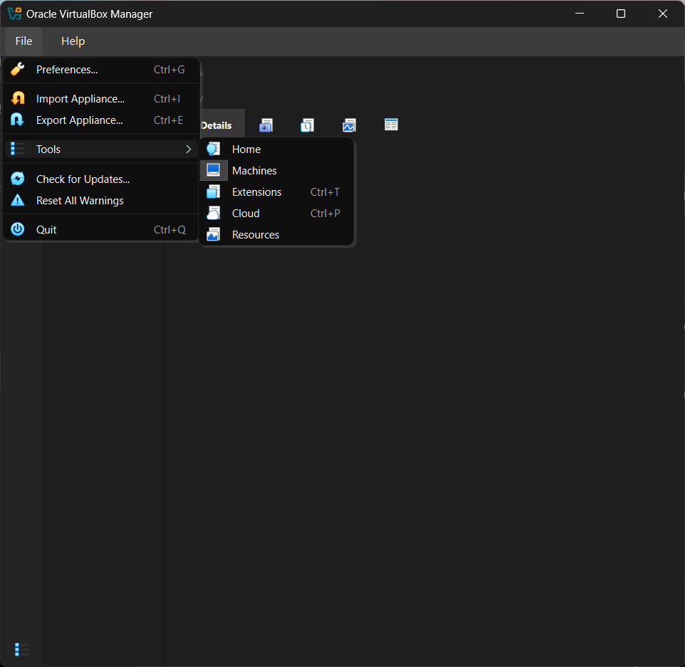
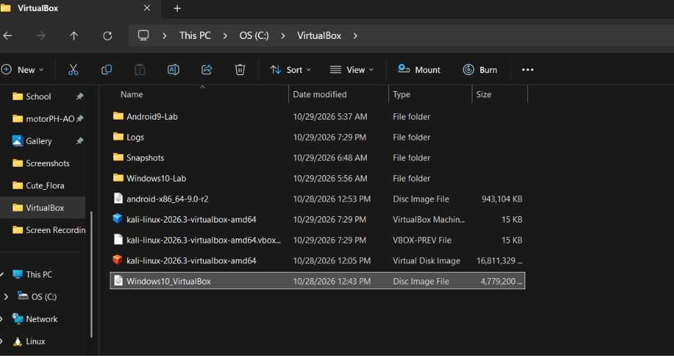
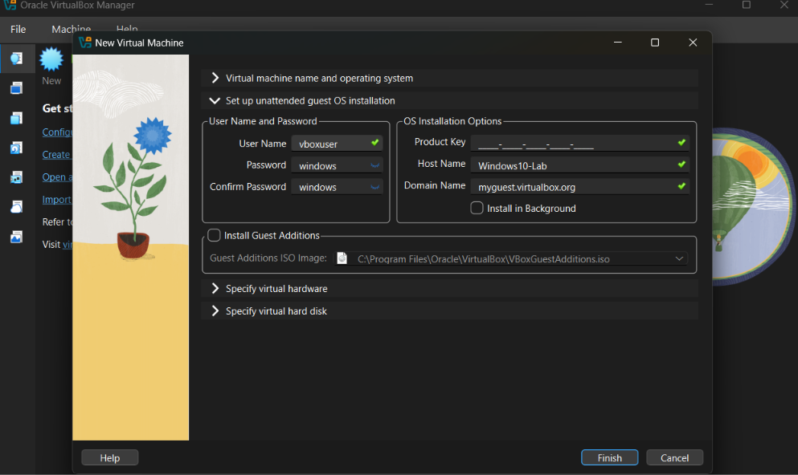
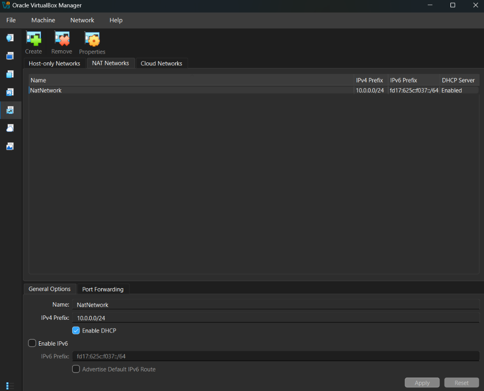
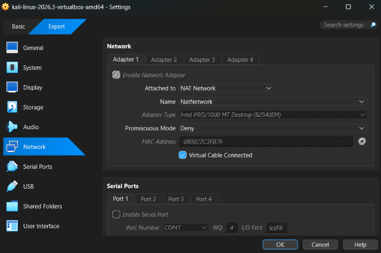
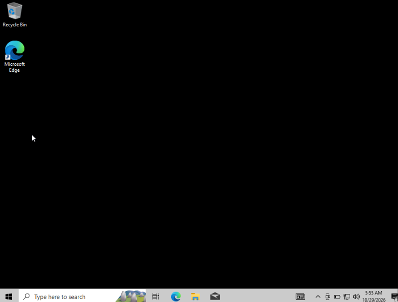
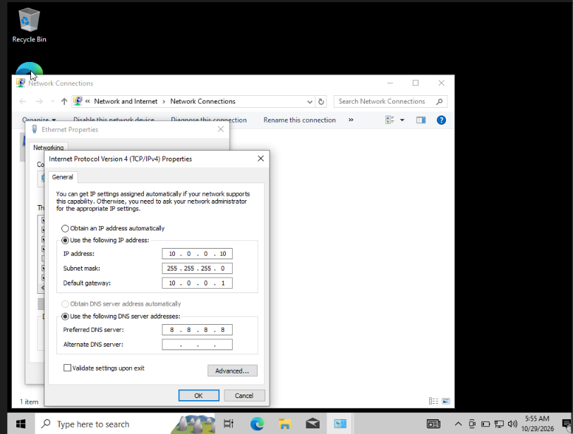
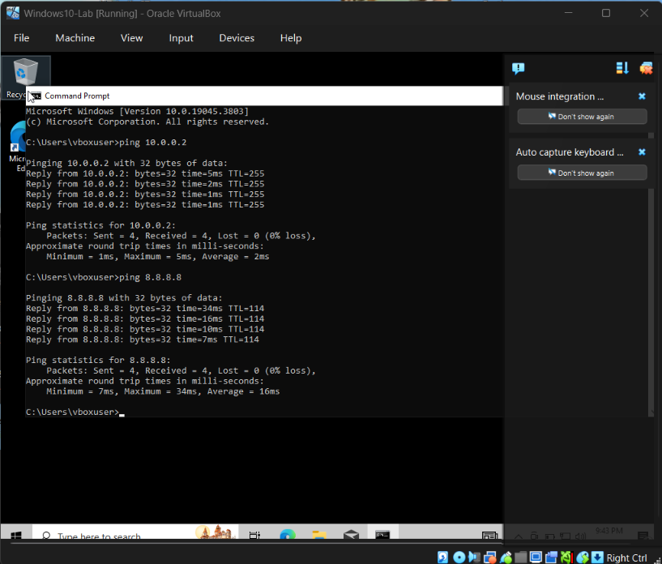

# NETWORKWALKS-B084-WK1-PM1-CYBERSECURITY-LAB-SETUP

Good day, everyone! My name is Trisha Dela Cruz. Here is the Windows 10 VM work I completed this week.

## 🪟 Windows 10 Virtual Lab Setup

I set up Windows 10 in Oracle VirtualBox to learn about virtual machines, network configuration, and communication between Windows and Kali Linux in a lab environment.

## 📌 Project Overview

This project documents the setup of a Windows 10 virtual machine in Oracle VirtualBox and its network connection with my Kali Linux VM.

## 🎯 Objectives

- Create and configure a Windows 10 VM in VirtualBox.
- Review the VM’s hardware and network settings.
- Assign a static IP address to Windows 10.
- Connect Windows 10 and Kali Linux to the same NAT Network.
- Test connectivity between the VMs.
- Document the setup with screenshots.

## 🛡️ Purpose of the Lab

The Windows 10 VM is for coursework and authorized cybersecurity practice. It helps me learn about:

- Windows settings.
- IP address and DNS configuration.
- Communication between virtual machines.
- Network troubleshooting and connectivity testing.

## 🏗️ Lab Architecture


Both the Windows 10 and Kali Linux VMs are connected to the same NAT Network, allowing them to communicate with each other.

## ⚙️ Lab Configuration

| Component | Configuration |
|---|---|
| Host OS | Windows 10 |
| Host RAM | 8 GB |
| Processor | AMD Ryzen 7 |
| Hypervisor | VirtualBox 7.2 |
| Windows VM | Windows 10 |
| Kali VM | Kali Linux 2026.3 |
| Kali VM RAM | 2048 MB |
| Virtual Network | NAT Network |
| Network Address | 10.0.0.0/24 |
| Windows 10 IP | 10.0.0.10/24 |
| Kali IP | 10.0.0.2/24 |
| Default Gateway | 10.0.0.1 |
| DNS Server | 8.8.8.8 |
| Future VM Range | 10.0.0.3–10.0.0.99 |

## 🪜 Lab Setup Procedure

### Step 1. Download the Required Software

I downloaded Oracle VirtualBox and prepared the Windows 10 installation files.



### Step 2. Set Up the Windows 10 VM

I created a new virtual machine in VirtualBox, selected Windows 10, configured its settings, and prepared its virtual hard disk.





### Step 3. Configure the NAT Network

I connected both the Windows 10 and Kali Linux VMs to a NAT Network with the address `10.0.0.0/24`.





### Step 4. Start Windows 10

I started the Windows 10 VM and checked that the desktop loaded successfully.



### Step 5. Assign the Windows 10 IP Address

I opened the Ethernet adapter settings, selected **Internet Protocol Version 4 (TCP/IPv4)**, and entered:

- IP address: `10.0.0.10`
- Subnet mask: `255.255.255.0`
- Default gateway: `10.0.0.1`
- Preferred DNS server: `8.8.8.8`



### Step 6. Test Connectivity to Kali Linux

I opened Command Prompt in Windows and tested the Kali VM’s IP address:

```cmd
ping 10.0.0.2
```

The ping test succeeded, confirming that Windows 10 could communicate with Kali Linux over the NAT Network.




### Step 7. Take A snapshot 
The final step is to take a snapshot of the virtual machine. This saves a restore point so I can return to this setup if I make changes or run into problems later.

## 🔎 Lab Verification

The ping test from Windows 10 to Kali Linux was successful.

- Windows 10 IP: `10.0.0.10`
- Kali Linux IP: `10.0.0.2`
- Default gateway: `10.0.0.1`
- DNS server: `8.8.8.8`

## 🐞 Problem Encountered and Solution

### Difficulty Finding the Windows IP Settings

I had difficulty finding where to assign the IP address in Windows 10. I opened the network adapter’s **Properties**, selected **Internet Protocol Version 4 (TCP/IPv4)**, then opened its **Properties** to enter the static IP settings.

## 💡 What I Learned

Through this lab, I practiced:

1. Creating a Windows 10 virtual machine in VirtualBox.
2. Connecting two VMs to the same NAT Network.
3. Assigning a static IPv4 address in Windows.
4. Using Command Prompt to test connectivity.
5. Troubleshooting basic VM network settings.

## 🔐 Security and Ethical Use

This environment is for coursework and authorized testing only. Do not scan, access, or test systems without permission.

## 🔗 Tools and Resources

- Oracle VirtualBox: https://www.virtualbox.org/wiki/Downloads
- Windows 10 download: https://www.microsoft.com/en-us/software-download/windows10

## 👤 Author

Trisha Gayle Dela Cruz  
B084