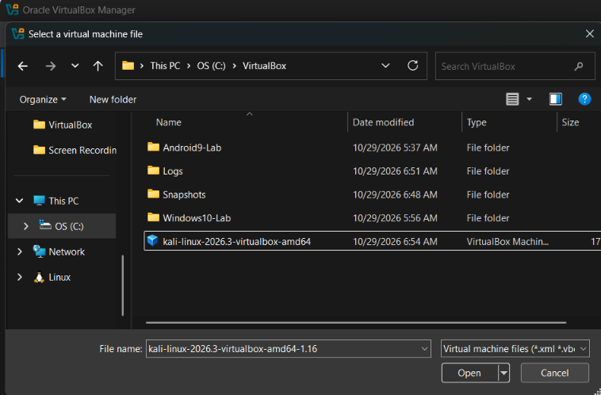
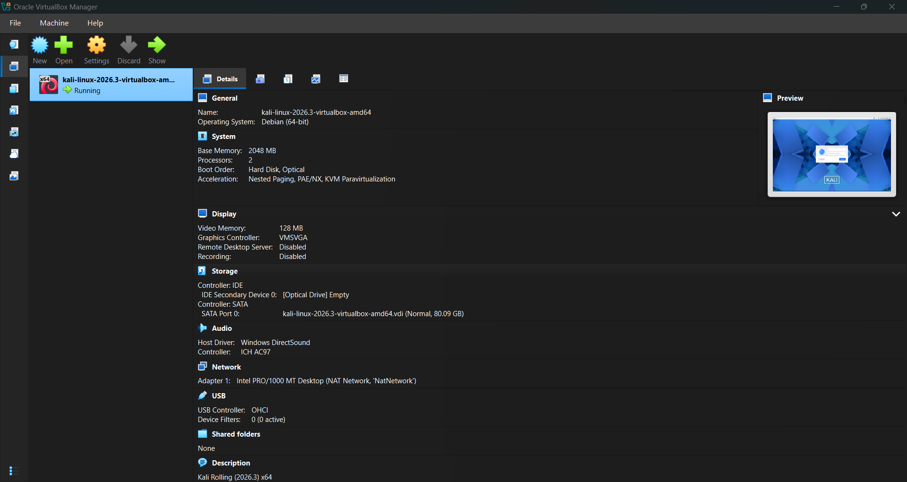
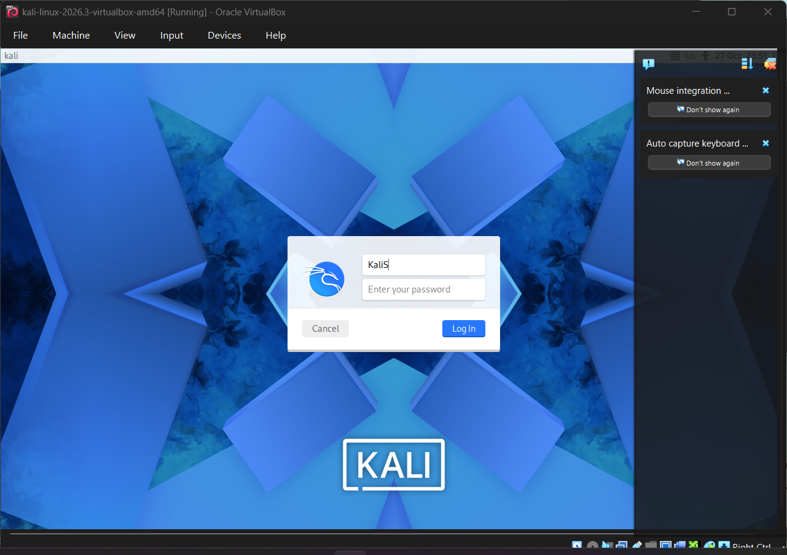
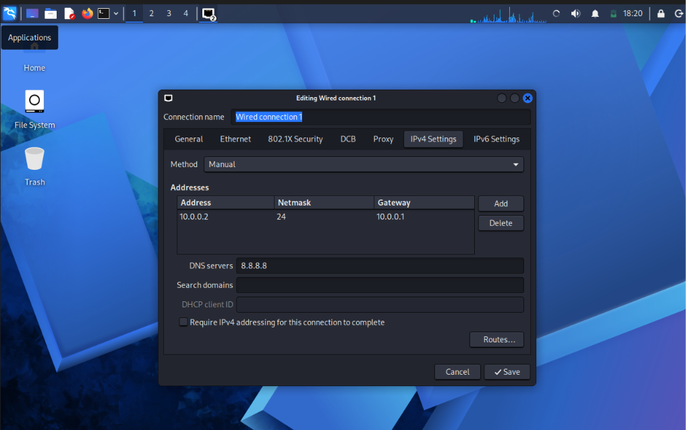
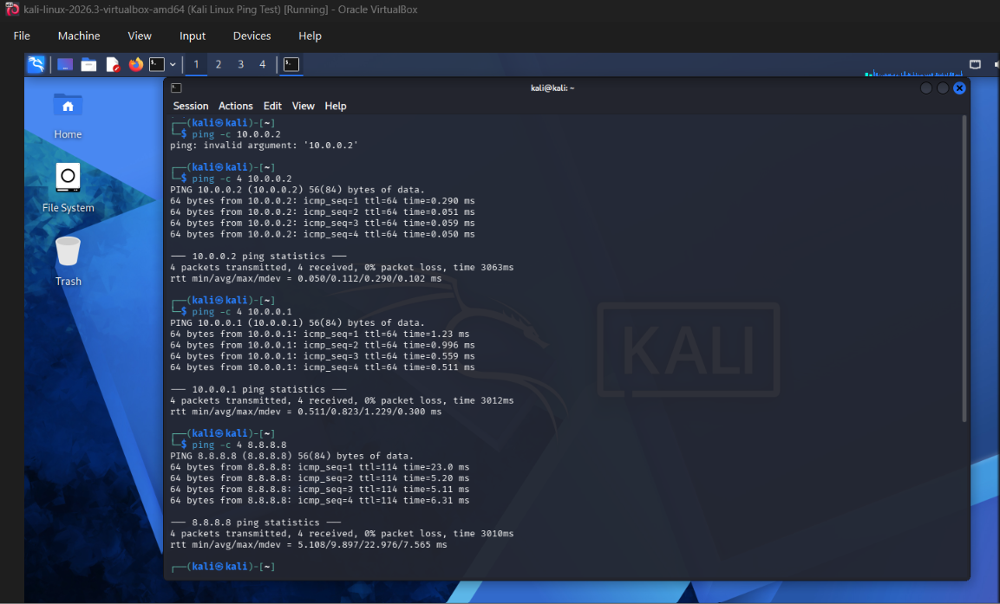

# NETWORKWALKS-B084-WK1-PM1-CYBERSECURITY-LAB-SETUP

Good day, everyone! My name is Trisha Dela Cruz. Here is the work I completed this week.

## 🔐 Kali Linux Virtual Lab Setup

This week, I set up Kali Linux in Oracle VirtualBox on my laptop to learn about cybersecurity tools and how they are used in the cybersecurity industry.

## 📌 Project Overview

This project documents the setup of a Kali Linux virtual machine in Oracle VirtualBox.

The goal is to create a virtual environment where I can practice using Kali Linux, configure network settings, and perform basic connectivity tests.

## 🎯 Objectives

- Download and import Kali Linux into VirtualBox.
- Review the VM’s memory, processor, display, and network settings.
- Configure a NAT Network for communication between virtual machines.
- Assign a static IP address to the Kali Linux VM.
- Check the IP address, gateway, DNS, and network connectivity.
- Document the setup with screenshots.

## 🛡️ Purpose of the Lab

This VM is for coursework and authorized cybersecurity practice. It can be used to learn:

- Linux command-line basics.
- Network configuration and troubleshooting.
- Cybersecurity tools.
- Basic network connectivity testing.
- Testing within an isolated lab.

Only test systems you own or have permission to assess.

## 🏗️ Lab Architecture


The Kali Linux VM uses a NAT Network in VirtualBox. This allows it to access external networks and communicate with other VMs connected to the same NAT Network, such as my Windows 10 VM.

## ⚙️ Lab Configuration

| Component | Configuration |
|---|---|
| Host OS | Windows 10 |
| Host RAM | 8 GB |
| Processor | AMD Ryzen 7 |
| Hypervisor | VirtualBox 7.2 |
| Kali Linux | 2026.3, 64-bit |
| Kali VM RAM | 2048 MB |
| Virtual Network | NAT Network |
| Network Address | 10.0.0.0/24 |
| Kali IP Address | 10.0.0.2/24 |
| Default Gateway | 10.0.0.1 |
| DNS Server | 8.8.8.8 |
| Future VM Range | 10.0.0.3–10.0.0.99 |

## 🪜 Lab Setup Procedure

### Step 1. Download the Required Software

I downloaded Oracle VirtualBox and the prebuilt Kali Linux VirtualBox image from their official websites. I extracted the Kali archive and prepared the VM for VirtualBox.


### Step 2. Add the Kali Linux VM

I added the extracted Kali Linux virtual machine in VirtualBox and reviewed its memory, processor, and storage settings.





### Step 3. Configure the NAT Network

I configured a NAT Network so Kali Linux and Windows 10 could communicate with each other.

- Network address: `10.0.0.0/24`
- Default gateway: `10.0.0.1`
- Network mode: NAT Network


### Step 4. Start Kali Linux

I started the Kali Linux VM, checked that it launched, and signed in.



### Step 5. Assign a Static IP Address

I opened the network icon’s menu, selected **Edit Connections**, and entered the IPv4 settings:

- IP address: `10.0.0.2`
- Subnet mask: `255.255.255.0`
- Default gateway: `10.0.0.1`
- DNS server: `8.8.8.8`



### Step 6.Take A snapshot
The final step is to take a snapshot of the virtual machine. This saves a restore point so I can return to this setup if I make changes or run into problems later.


## 🔎 Lab Verification

I used ping tests to check connectivity from Kali Linux. My configured values were:

- IP address: `10.0.0.2`
- Gateway: `10.0.0.1`
- DNS: `8.8.8.8`



## 🐞 Problems Encountered and Solutions

### Problem 1. Network Disconnected After Setting the IP Address

After assigning the static IP address, my network connection disconnected. I restarted the connection with:

```bash
sudo nmcli connection modify "Wired connection 1" ipv4.dad-timeout 0
sudo nmcli connection down "Wired connection 1"
sudo nmcli connection up "Wired connection 1"
```

### Problem 2. Finding the IP Address Settings

I had trouble finding where to set the IP address. I right-clicked the network icon, selected **Edit Connections**, and opened the IPv4 settings.

### Problem 3. Kali Download Was Blocked

Windows Security blocked the Kali download. Use a download from the official Kali website and verify its SHA-256 checksum before using it. Keep Windows Security enabled.

## 💡 What I Learned

Through this lab, I practiced:

1. Importing a Linux virtual machine into VirtualBox.
2. Reviewing VM hardware and network settings.
3. Configuring a NAT Network.
4. Setting and checking a static IP address.
5. Using Linux commands to check routes and connectivity.
6. Troubleshooting basic network issues.

## 🔐 Security and Ethical Use

This lab is for education and authorized testing only. Do not scan, access, or test systems without permission.

## 🔗 Tools and Resources

- Kali Linux: https://www.kali.org/get-kali/
- Oracle VirtualBox: https://www.virtualbox.org/wiki/Downloads

## 👤 Author

Trisha Gayle Dela Cruz  
B084